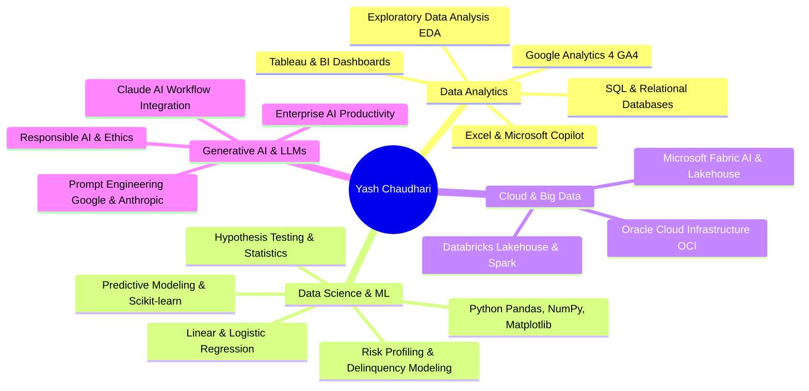

# 🎓 Professional Certifications & Credentials Repository

<div align="center">

# Yash Devidas Chaudhari

**Data Science • Data Analytics • Cloud Platforms • Generative AI & Prompt Engineering**

[](https://github.com/yashchaudhari372-lab)
[](mailto:Yashchaudhari372@gmail.com)

---

[](https://python.org)
[](https://www.mysql.com)
[](https://tableau.com)
[](https://analytics.google.com)
[](https://cloud.oracle.com)
[](https://learn.microsoft.com)
[](https://databricks.com)
[](https://coursera.org)

</div>

---

## 📌 Repository Overview

This repository is an official, organized showcase of all accredited certifications, specializations, verified badges, industry job simulations, and internship completion certificates earned by **Yash Chaudhari**.

Each credential listed below links directly to the verified certificate document stored in this repository and includes third-party verification URLs and Credential IDs wherever issued.

---

## 📂 Repository Directory Structure

```text
├── Internship/
│   └── Ybi-Foundation-Data-Science-and-Machine-Learning-Internship.pdf
├── Cloud-and-Platforms/
│   ├── Oracle-Cloud-Infrastructure-AI-Foundations-Associate.pdf
│   ├── Google-Analytics-Certification-2026.pdf
│   ├── Microsoft-Fabric-Data-Science-and-ML-Solution.pdf
│   ├── Databricks-Generative-AI-Fundamentals-Accreditation.pdf
│   └── Databricks-Generative-AI-Fundamentals-Badge.png
├── Specializations-and-Courses/
│   ├── Google-Coursera-Prompting-Essentials-Specialization.pdf
│   ├── Google-Coursera-Start-Writing-Prompts-like-a-Pro.pdf
│   ├── Google-Coursera-Speed-Up-Data-Analysis-and-Presentation-Building.pdf
│   ├── Google-Coursera-Use-AI-as-a-Creative-or-Expert-Partner.pdf
│   ├── Google-Coursera-AI-Essentials-Specialization.pdf
│   ├── Google-Coursera-Introduction-to-AI.pdf
│   ├── Google-Coursera-Maximize-Productivity-With-AI-Tools.pdf
│   ├── Google-Coursera-Discover-the-Art-of-Prompting.pdf
│   ├── Google-Coursera-Use-AI-Responsibly.pdf
│   ├── Cisco-Data-Science-Essentials-with-Python-Certificate.pdf
│   ├── Cisco-Data-Science-Essentials-with-Python-Completion-Letter.pdf
│   ├── Cisco-Data-Analytics-Essentials-Certificate.pdf
│   ├── Cisco-Data-Analytics-Essentials-Completion-Letter.pdf
│   ├── IBM-SkillsBuild-Data-Preparation-for-Analysis.pdf
│   ├── IBM-SkillsBuild-Getting-Started-with-Artificial-Intelligence.pdf
│   ├── Claude-Academy-AI-Fluency-Framework-and-Foundations.pdf
│   ├── LinkedIn-Learning-Excel-with-Copilot-AI-Driven-Data-Analysis.pdf
│   ├── HP-LIFE-AI-for-Beginners.pdf
│   └── Accenture-Introduction-to-Gen-AI.pdf
├── Virtual-Job-Simulations/
│   ├── Tata-GenAI-Powered-Data-Analytics-Job-Simulation.pdf
│   ├── Tata-Data-Visualisation-Empowering-Business-Insights.pdf
│   ├── Deloitte-Data-Analytics-Job-Simulation.pdf
│   ├── Deloitte-Technology-Job-Simulation.pdf
│   └── British-Airways-Data-Science-Job-Simulation.pdf
└── Workshops/
    └── be10x-AI-Tools-and-Claude-Workshop.pdf
```

---

## 💼 1. Internship Experience

| Role | Organization | Period | Credential ID | Certificate File |
| :--- | :--- | :--- | :--- | :--- |
| **Data Science and Machine Learning Intern** | **Ybi Foundation** | Aug 2024 (1 Month) | `Z9FA7WTVH08PQ` | [📄 View Certificate](Internship/Ybi-Foundation-Data-Science-and-Machine-Learning-Internship.pdf) |

> **Highlights:** Practical implementations of supervised & unsupervised machine learning pipelines, exploratory data analysis, data preparation in Python, and model evaluation under ISO 9001:2015 certified standards.

---

## ☁️ 2. Cloud & Enterprise Platform Certifications

| Certification | Issuing Organization | Issue Date | Expiry / Validity | Credential ID / Verification | File Link |
| :--- | :--- | :--- | :--- | :--- | :--- |
| **Oracle Cloud Infrastructure Certified AI Foundations Associate** | Oracle University | Oct 10, 2026 | Oct 10, 2028 | `103558524OCI26AICFA` | [📄 View Certificate](Cloud-and-Platforms/Oracle-Cloud-Infrastructure-AI-Foundations-Associate.pdf) |
| **Google Analytics Certification (2026)** | Google | Nov 11, 2026 | Nov 11, 2027 | `200113766` | [📄 View Certificate](Cloud-and-Platforms/Google-Analytics-Certification-2026.pdf) |
| **Databricks Accredited Generative AI Fundamentals** | Databricks Academy | Nov 12, 2026 | Lifetime | Accredited Partner | [📄 View Certificate](Cloud-and-Platforms/Databricks-Generative-AI-Fundamentals-Accreditation.pdf) • [🏅 Badge](Cloud-and-Platforms/Databricks-Generative-AI-Fundamentals-Badge.png) |
| **Implement Data Science and ML Solution for AI in Microsoft Fabric** | Microsoft Learn | Oct 17, 2026 | Lifetime | [Microsoft Transcript](https://learn.microsoft.com/en-in/users/yashchaudhari-4143/) | [📄 View Certificate](Cloud-and-Platforms/Microsoft-Fabric-Data-Science-and-ML-Solution.pdf) |

---

## 🎓 3. Multi-Course Specializations & Professional Academies

### A. Google Specializations (Coursera)

| Specialization / Course Name | Completion Date | Verification Link | File Link |
| :--- | :--- | :--- | :--- |
| **Google Prompting Essentials Specialization** | Nov 14, 2026 | [Verify Specialization](https://coursera.org/verify/specialization/X8LENXSLTD60) | [📄 View Certificate](Specializations-and-Courses/Google-Coursera-Prompting-Essentials-Specialization.pdf) |
| ↳ *Start Writing Prompts like a Pro* | Nov 14, 2026 | [Verify Course](https://coursera.org/verify/XFFDTEYURSW3) | [📄 View Certificate](Specializations-and-Courses/Google-Coursera-Start-Writing-Prompts-like-a-Pro.pdf) |
| ↳ *Speed Up Data Analysis and Presentation Building* | Nov 14, 2026 | [Verify Course](https://coursera.org/verify/Y30HCZ28S9UW) | [📄 View Certificate](Specializations-and-Courses/Google-Coursera-Speed-Up-Data-Analysis-and-Presentation-Building.pdf) |
| ↳ *Use AI as a Creative or Expert Partner* | Nov 14, 2026 | [Verify Course](https://coursera.org/verify/2GTONCNJ3ZKZ) | [📄 View Certificate](Specializations-and-Courses/Google-Coursera-Use-AI-as-a-Creative-or-Expert-Partner.pdf) |
| **Google AI Essentials Specialization** | Nov 14, 2026 | [Verify Specialization](https://coursera.org/verify/specialization/VN2NOH37JE7P) | [📄 View Certificate](Specializations-and-Courses/Google-Coursera-AI-Essentials-Specialization.pdf) |
| ↳ *Introduction to AI* | Nov 13, 2026 | [Verify Course](https://coursera.org/verify/YYFNN4BJGHE7) | [📄 View Certificate](Specializations-and-Courses/Google-Coursera-Introduction-to-AI.pdf) |
| ↳ *Maximize Productivity With AI Tools* | Nov 13, 2026 | [Verify Course](https://coursera.org/verify/JK1RZ2E4XPIG) | [📄 View Certificate](Specializations-and-Courses/Google-Coursera-Maximize-Productivity-With-AI-Tools.pdf) |
| ↳ *Discover the Art of Prompting* | Nov 13, 2026 | [Verify Course](https://coursera.org/verify/AA9MZ9LR415B) | [📄 View Certificate](Specializations-and-Courses/Google-Coursera-Discover-the-Art-of-Prompting.pdf) |
| ↳ *Use AI Responsibly* | Nov 13, 2026 | [Verify Course](https://coursera.org/verify/TU99081XTWTA) | [📄 View Certificate](Specializations-and-Courses/Google-Coursera-Use-AI-Responsibly.pdf) |

### B. Cisco Networking Academy

| Program | Completion Date | Credential ID | Certificate / Completion Letter |
| :--- | :--- | :--- | :--- |
| **Data Science Essentials with Python** | Oct 06, 2026 | `40114c9c-9ea3-438c-9a4a-5c873c7d21dd` | [📄 Certificate](Specializations-and-Courses/Cisco-Data-Science-Essentials-with-Python-Certificate.pdf) • [📄 Completion Letter](Specializations-and-Courses/Cisco-Data-Science-Essentials-with-Python-Completion-Letter.pdf) |
| **Data Analytics Essentials** | Oct 10, 2026 | `c62177e6-791a-4f1e-913e-95595bc92369` | [📄 Certificate](Specializations-and-Courses/Cisco-Data-Analytics-Essentials-Certificate.pdf) • [📄 Completion Letter](Specializations-and-Courses/Cisco-Data-Analytics-Essentials-Completion-Letter.pdf) |

### C. IBM SkillsBuild (Credly Verified Badges)

| Credential | Issuer | Issue Date | Verification Link | File Link |
| :--- | :--- | :--- | :--- | :--- |
| **Data Preparation for Analysis** | IBM SkillsBuild | Oct 06, 2026 | [Credly Verification](https://www.credly.com/badges/66582207-d53b-46bb-8489-1ec6db2dd858) | [📄 View Certificate](Specializations-and-Courses/IBM-SkillsBuild-Data-Preparation-for-Analysis.pdf) |
| **Getting Started with Artificial Intelligence** | IBM SkillsBuild | Nov 16, 2026 | [Credly Verification](https://www.credly.com/badges/7d724563-9ea8-4835-89ed-f82fa70c3980) | [📄 View Certificate](Specializations-and-Courses/IBM-SkillsBuild-Getting-Started-with-Artificial-Intelligence.pdf) |

### D. Anthropic Ecosystem & AI Upskilling

| Program | Issuer | Issue Date | Credential / ID | File Link |
| :--- | :--- | :--- | :--- | :--- |
| **AI Fluency: Framework and Foundations** | Claude Academy | Nov 11, 2026 | [Verify Badge](https://academy.claude.com/verify/710f6027734ea6adda6528a029c4e76a) | [📄 View Certificate](Specializations-and-Courses/Claude-Academy-AI-Fluency-Framework-and-Foundations.pdf) |
| **Excel with Copilot: AI-Driven Data Analysis** | LinkedIn Learning | Nov 03, 2026 | `84c86c61c3e26e17ffc678addf19535cdf39133e244472bebb6e4d29703cc2c7` | [📄 View Certificate](Specializations-and-Courses/LinkedIn-Learning-Excel-with-Copilot-AI-Driven-Data-Analysis.pdf) |
| **AI for Beginners** | HP LIFE / HP Foundation | Nov 12, 2026 | `eee4ab08-d875-42a1-9faf-f5a259b75996` | [📄 View Certificate](Specializations-and-Courses/HP-LIFE-AI-for-Beginners.pdf) |
| **Introduction to Gen AI** | Accenture | Nov 11, 2026 | Online Course Completion | [📄 View Certificate](Specializations-and-Courses/Accenture-Introduction-to-Gen-AI.pdf) |

---

## 🏢 4. Industry Virtual Job Simulations (Forage)

Practical work simulations demonstrating hands-on business analytics, data engineering, and machine learning problem-solving:

| Organization | Simulation Program | Completion Date | Key Applied Skills | File Link |
| :--- | :--- | :--- | :--- | :--- |
| **Tata** | **GenAI Powered Data Analytics** | Oct 04, 2026 | EDA, Risk profiling, AI-powered delinquency prediction, collections business storytelling. | [📄 View Certificate](Virtual-Job-Simulations/Tata-GenAI-Powered-Data-Analytics-Job-Simulation.pdf) |
| **Tata** | **Data Visualisation: Empowering Business with Effective Insights** | Sep 27, 2026 | Framing business scenarios, selecting visualizations, high-impact executive dashboards. | [📄 View Certificate](Virtual-Job-Simulations/Tata-Data-Visualisation-Empowering-Business-Insights.pdf) |
| **Deloitte** | **Data Analytics Job Simulation** | Nov 07, 2026 | Data extraction, forensic technology, data integrity analysis. | [📄 View Certificate](Virtual-Job-Simulations/Deloitte-Data-Analytics-Job-Simulation.pdf) |
| **Deloitte** | **Technology Job Simulation** | Nov 07, 2026 | Coding, algorithm logic, system design and development. | [📄 View Certificate](Virtual-Job-Simulations/Deloitte-Technology-Job-Simulation.pdf) |
| **British Airways** | **Data Science Job Simulation** | Nov 09, 2026 | Heathrow T3 lounge eligibility modeling, customer booking behavior prediction algorithms. | [📄 View Certificate](Virtual-Job-Simulations/British-Airways-Data-Science-Job-Simulation.pdf) |

---

## 🛠️ 5. Specialized Workshops

| Workshop | Host | Date | Core Competencies | File Link |
| :--- | :--- | :--- | :--- | :--- |
| **AI Tools & Claude Workshop** | **be10x** | Nov 15, 2026 | Rapid presentation generation (<5 min), AI-assisted data analysis (<30 min), automated coding & debugging (<10 min). | [📄 View Certificate](Workshops/be10x-AI-Tools-and-Claude-Workshop.pdf) |

---

## 📊 Technical Skills & Competencies Summary



---

## 🛡️ Verification & Authenticity

All credentials listed here have been officially awarded to **Yash Devidas Chaudhari (Yash Chaudhari)**. Verification links are active and route to their respective certifying authorities (Coursera, Credly, Oracle, Cisco, Claude Academy, LinkedIn Learning, Microsoft Learn, and Forage).

---
<div align="center">
  <sub>Maintained by <a href="https://github.com/yashchaudhari372-lab">Yash Chaudhari</a> • © 2026 All Rights Reserved</sub>
</div>
